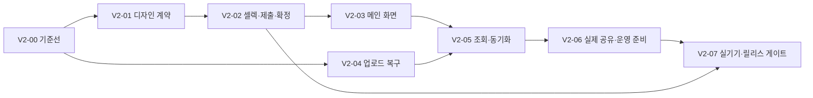

# 설렉 v2 대규모 개선 패치 계획

> **기획 기준 변경:** 사용자의 후속 지시에 따라 [설렉 v2 심플 개편안](seollek-v2-simple-product-brief.md)을 우선한다. 이 문서는 기술 개선 후보와 검증 근거로 보관한다. 네 탭·앨범 우선 진입·기존 화면 구성의 유지 및 8단계 Ruflo 워크플로는 새 개편안 확정 없이 그대로 실행하지 않는다.

작성: 2026-10-22 · 상태: 계획안 · 앱 구현/배포/DB 변경 전

**목표: 사진을 올리고, 친구와 고르고, 최종 조합을 남기는 경험을 완성한다.** 기존 Expo 앱을 개선하며 전면 재작성하지 않는다. v2의 범위는 시각 디자인, 핵심 동선, 사진 복구, 데이터 일관성, 실제 공유 및 출시 준비다.

## 기준과 확인 범위

- 기준 소스: `f17d9fc` 및 현재 작업 폴더의 미커밋 9개 파일. 기존 변경을 되돌리거나 덮어쓰지 않았다.
- README, 최신 기획 후속 변경, 메인 구조·UIUX·업로드 문서와 실제 화면/저장/도메인 코드를 함께 확인했다. 과거 와이어프레임보다 최신 소스와 합의된 정책을 우선한다.
- Code Review Graph를 갱신하고 구조·영향 관계를 확인했다. 그래프의 위험 점수와 테스트 갭은 탐색용 추정이며 결함 수나 테스트 커버리지로 해석하지 않는다. 축약 importer 조회가 빈 객체를 반환한 부분은 소스 import로 확인했다.
- Ruflo 스킬을 읽고 `hooks_route`와 `workflow_create`를 사용했다. 한국어 라우팅은 키워드 미일치로 기본 추천을 반환했으므로 역할 배분의 근거로 쓰지 않았다.
- 디자인 URL의 웹 본문과 브라우저 대표 이미지를 확인했다. 보이는 대표 시안은 웰니스 앱이며 밝은 화면, 부드러운 파스텔, 둥근 카드, 가벼운 타이포그래피와 여백을 보여준다. 전체 갤러리를 검토한 것은 아니다.
- 실서버 접속·실제 사용자 사진·iPhone 실기기 검증은 이번 계획 작성에서 수행하지 않았다. 기존 문서의 통과 이력은 이번 실행 결과와 구분한다.

## 유지할 제품 계약

1. 앨범 안에 여러 요청을 둔다. 역할은 요청 소유자로 판단하며 별도 역할 모드를 만들지 않는다. 앨범 최대 3명 정책을 유지한다.
2. 분류는 **별로 / 글쎄 / 좋아**. 미분류와 글쎄를 구분한다. 스와이프는 탐색, 버튼은 분류이며 저장 성공 후 다음 사진으로 이동한다.
3. 모든 사진을 분류한 뒤 셀렉을 제출한다. 좋아 0장 제출을 허용한다. 제출과 요청자의 최종 확정은 서로 다른 행동이다.
4. 분류 수정은 수정자의 제출만, 사진 추가는 해당 요청의 모든 제출을 무효화한다. 최종 확정 후 분류·의견은 읽기 전용이다. 최종 확정은 1장 이상이다.
5. 원본과 미리보기를 분리하고 크기·체크섬을 검증한다. 여기서 원본은 선택기가 전달한 파일이며 카메라 파일과의 동일성은 별도 문제다.
6. 기존 앨범/요청 ID, 초대 경로와 저장 데이터의 호환성을 유지한다. 브라우저 로컬 데이터가 자동으로 클라우드에 이관된다고 안내하지 않는다.

## 디자인 방향: 부드러운 첫인상, 선명한 사진 판단

참고: [lazy kar — Mobile App Design UI UX](https://dribbble.com/services/1781-Mobile-app-design-ui-ux).

아래 값은 참고 이미지에서 추출한 수치가 아니라 **설렉에 맞춘 제안 토큰**이다. 원본 일러스트·폰트·아이콘·레이아웃을 복제하지 않는다.

| 요소 | v2 제안 | 적용 이유 |
|---|---|---|
| 바탕/표면 | 따뜻한 흰색 `#FCFBF8`, 흰색 카드 | 사진을 주인공으로 유지 |
| 본문/보조 | `#252525` / `#62675F` | 작은 설명도 읽기 쉽게 구성; 실제 대비는 구현 때 검증 |
| 브랜드 포인트 | 기존 테라코타 `#D07758` | 설렉의 기존 인상을 이어감. 작은 본문색으로 남용하지 않음 |
| 분위기 색 | 연한 라일락 `#EEEAF7`, 세이지 `#E8EEE5`, 피치 `#F8E8DF` | 홈의 상태·빈 화면에 제한적으로 사용 |
| 주 행동 | 진한 중립색 버튼 1개 | 한 화면에서 다음 행동을 바로 찾음 |
| 형태 | 카드 20px, 패널 24px, 입력/버튼 14~16px | 기존 둥근 형태를 정돈 |
| 간격/글자 | 4/8/12/16/24/32 간격; 제목 28~32, 본문 16, 보조 13~14 | 화면마다 반복되는 위계 정립 |
| 조작 | 터치 영역 최소 44×44; 색+문자+선택 표시 | 한 손 조작, 색각 차이와 보조기술 대응 |
| 모션 | 저장 확인과 다음 사진 전환에 짧게 사용 | 원본을 동시에 디코딩하는 효과를 피하고 모션 감소 설정 대응 |

첫 디자인 산출물은 **홈·앨범 상세·사진 상세·제출 확인의 4개 화면**이다. 390px 기준으로 만들고 320px 폭·큰 글자에서도 확인한다. 대표 디자인을 정한 뒤 같은 규칙을 나머지 화면에 확장한다.

| 화면 | 정보 배치와 대표 행동 | 추가 설계할 상태 |
|---|---|---|
| 온보딩 | 작은 브랜드 소개 → 닉네임 → 시작. 초대 진입 맥락 보존 | 첫 방문, 기존 세션, 초기화 실패 |
| 홈 | 간결한 인사 → 지금 할 셀렉 1개 강조 → 나머지 진행 목록 → 최근 앨범 | 내 미분류, 제출 후 대기, 요청자 확정 가능, 빈 홈 |
| 앨범 모음/상세 | 표지 중심 2열; 상세는 참여자와 내 요청/친구 요청, 상태별 CTA | 빈 앨범, 준비 중, 제출 취소됨, 확정됨 |
| 요청 | 제목·소유자·참여 현황 → 사진 → 이어 고르기. 초대/관리 보조 배치 | 사진 0장, 모두 분류, 내 제출 완료, 접근 불가 |
| 사진 상세 | 상단 순번/진행 → 전체 사진 contain → 현재 선택 → 세 분류 버튼 | 저장 중, 저장 실패, 마지막 미분류, 확정 후 읽기 전용 |
| 제출 확인/완료 | 좋아 조합과 세 분류 수 → 셀렉 제출; 완료 후 앨범 복귀 | 좋아 0장, 새 사진 추가로 재분류 필요, 수정으로 재제출 필요 |
| 최종 선택/결과 | 참여자별 제출 조합 참고 → 전체 사진 중 선택 → 확정 전 확인 | 아직 미제출 참여자, 확정 충돌, 네이티브 부분 저장 실패 |
| 업로드 | 전체 완료 수 → 현재 처리 파일 → 실패 항목 → 이어하기 | 파일 전달 대기, 저장공간 부족, 파일 재선택, 세션 만료 |
| 친구/마이페이지 | 함께한 사람·공유 앨범, 닉네임·데이터 보관 안내 | 친구 없음, 닉네임 저장 실패, 로컬 모드 안내 |

네 탭과 기존 라우팅을 유지한다. 사진 상세·업로드·제출에서는 작업 버튼에 집중한다. 홈의 큰 브랜드 영역은 축소하고 할 일을 첫 화면에 올린다. 미제출 참여자가 있어도 현재 정책상 최종 확정할 수 있으므로 경고로 알리고 임의로 차단하지 않는다.

## 실제 코드에서 출발하는 개선 지점

| 확인한 구조 | 영향/검증할 문제 | 계획 |
|---|---|---|
| `store.tsx`에서 5초 폴링, `listRequests`가 모든 요청을 hydrate | 사진별 signed URL 생성과 여러 쿼리가 반복됨. 실제 병목 크기는 미측정 | V2-05에서 요청 수·전송량을 먼저 측정하고 목록/상세 조회 분리 |
| `refresh`가 진행 중 Promise를 기다린 후 새 fetch를 시작 | 대기 중 호출 여러 개가 깨어나면 중복 조회 가능 | 공유 Promise 또는 필요한 후속 갱신 1회로 합치고 경쟁 테스트 |
| `useRequest`에 요청 없음과 로딩/권한 오류 구별이 부족 | 존재하지 않는 주소가 불러오는 화면에 남을 가능성 | V2-02에서 로딩/없음/접근 불가/재시도 구별 |
| 네이티브 업로드 목록은 화면 state, 웹은 영속 큐 | 앱 종료 복구 보장이 플랫폼별로 다름 | V2-04에서 네이티브 작업 목록·파일 참조 영속화 |
| 웹은 등록 확인 후 정리, 네이티브는 업로드 catch에서 파일 정리 | 등록 성공 후 응답 유실 시 파일 정리 판단이 다름 | 등록 여부 재확인, 불명확하면 원본 보존, 재시도 ID 유지 |
| 재선택 복구는 이름·크기·MIME을 매칭 | 같은 메타데이터의 다른 파일을 혼동할 여지 | 복구할 때만 추가 식별/확인. 새 hash를 모든 화면에 노출하지 않음 |
| `photo-storage.ts`의 object URL 캐시는 해제 경로 없음 | 세션 중 사진 수 증가에 따른 메모리 유지 가능성 | 사용 수명 확인 후 안전한 정리 범위 설정; 임의 해제로 표시 중 사진을 깨지 않음 |
| 닉네임 변경은 AsyncStorage/현재 state 갱신 | 기존 앨범·요청 멤버 표시는 즉시 일치하지 않을 수 있음 | 기존 멤버 저장 모델을 유지하며 본인 표시 이름 갱신 경로 보완 |
| SQL에 멤버십 RLS·RPC·행 잠금·제출 무효화 트리거 존재 | 실서버 권한·경쟁 실행은 문서상 미검증 | 새 백엔드를 만들지 않고 기존 장치부터 검증 |

위 항목은 코드 관찰에 기반한 개선 후보다. 재현하지 않은 문제를 발생 확정 버그나 데이터 유출로 단정하지 않는다.

## 패치 묶음과 완료 조건

각 패치는 별도 리뷰 가능한 변경으로 만든다. 디자인 전체 적용과 저장 계층 변경을 한 커밋에 섞지 않는다.

| ID / 우선순위 | 변경 범위 | 주요 파일·함께 확인할 곳 | 완료 조건 |
|---|---|---|---|
| V2-00 / P0 | 현재 변경 기준선과 정책 고정 | 미커밋 9개 파일, 기존 테스트, 기획 문서 | 기존 변경의 의도·검증 결과 확인, 데이터 초기화 없이 재현 가능한 기준선 |
| V2-01 / P1 | 디자인 토큰·4화면 시안·기본 상태 | `ui.tsx`, `main-screens.tsx`, 사진 상세; 실제 적용은 다음 패치 | 320/390px와 큰 글자에서 핵심 CTA 확인, 대비·선택 상태·초점 규칙 명시 |
| V2-02 / P0 | 분류→제출→확정 수직 흐름 | `request-hook.ts`, `requests/[id]/{index,photo,review,submitted,select,result}.tsx`, `domain.ts`, `ui.tsx`, `tests/domain.test.ts` | 연속 탭/저장 실패 때 건너뛰기 없음; 좋아 0장 제출; 제출 무효화/확정 잠금 유지; 없는 URL 종료 상태 |
| V2-03 / P1 | 홈·앨범·친구·마이페이지 | `main-screens.tsx`, `app/(tabs)/`, `app/albums/[id].tsx`, 생성 화면 | 내 할 일과 대기를 구분; 기존 딥링크 유지; 빈 앨범에서 첫 요청까지 진행 가능 |
| V2-04 / P0 | 사진 입출력 신뢰성 | `upload-screen.tsx`, `.web.tsx`, `upload-queue.ts`, `upload-queue-storage.ts`, `repository.ts`, `photo-storage.ts`, `verify-original.ts`, 업로드/저장 테스트 | 중단·재시도·등록 응답 유실에도 사진 ID 유지 및 중복 없음; 이미 등록된 원본 보존; 네이티브 복구 검증 |
| V2-05 / P1 | 조회·동기화·닉네임 일관성 | `store.tsx`, `repository.ts`, `request-hook.ts`, `ui.tsx`, 목록 호출부와 추가 회귀 테스트 | 동시 refresh 중복 억제, 목록 폴링의 사진별 URL 재발급 제거, 만료 URL 재발급, 현재 화면 데이터 최신성 유지 |
| V2-06 / P0·공유 출시 전 | 실제 공유·초대·데이터 수명 | 기존 SQL, `backend.ts`, `repository.ts`, 초대/마이페이지, 새 후속 migration·권한 통합 테스트 | 3기기 권한/경쟁 테스트, 초대 폐기·교체, 계정/앨범 데이터 삭제·보관 정책 구현과 복구/실패 안내 |
| V2-07 / P0·출시 전 | 회귀·실기기·파일럿 | 자동 테스트, 웹 export, iPhone 테스트/체크리스트, README | 릴리스 게이트 통과 및 중단 조건/롤백 기록. 실제 배포는 별도 실행 단계 |

P0는 먼저 해결하거나 출시를 막는 항목, P1은 v2 경험·효율 개선이다. 일정은 서버 환경과 기기 검증 결과를 얻은 뒤 확정한다. 아래 순서는 설계 의존성이며 작업 시간 예측이 아니다.

## Ruflo 실행 설계

- 등록된 계획: `seollek-v2-patch-plan-20261022`
- workflow ID: `workflow-1792664396097-klzb3g`
- 도구 반환 상태: `ready`, 8단계 등록. **에이전트 실행·테스트 통과·배포 완료를 의미하지 않는다.** 이번에는 에이전트를 실행하지 않았다.
- `config.dependsOn`에는 계획상 의존성을 기록했다. 이 필드의 자동 스케줄링은 검증하지 않았다. 등록 순서는 순차 실행 가능한 안전한 순서다. 실행 전 실제 워크플로 도구의 지원 범위와 출력 바인딩을 확인한다.

| 역할 | 책임 | 소스 충돌 방지 |
|---|---|---|
| 조정/검토 | 기준선·정책·범위·수용 기준 관리 | 문서가 기준; 진행 보고만으로 완료 처리하지 않음 |
| 디자인 | 4화면 시안, 토큰, 상태·접근성 규칙 | V2-01에서 계약을 고정하고 전역 스타일 변경을 한 담당자에게 모음 |
| 셀렉/메인 구현 | V2-02·03 | `domain.ts`, `ui.tsx` 변경은 순차 통합 |
| 업로드/데이터 구현 | V2-04·05 | `repository.ts`, `store.tsx`는 동시 쓰기 금지 |
| 권한/검증 | V2-06·07, 경계·동시성·실기기 | 구현과 독립된 수용 시나리오로 판정 |

병렬 실행은 독립적인 읽기·시안 검토·테스트 설계부터 허용한다. 공유 파일의 구현은 순차 진행한다. 작업 인계에는 변경 파일, 유지 정책, 테스트 증거, 남은 위험을 남긴다. Ruflo 메모리에 원본 사진, 초대 토큰, 키, signed URL을 저장하지 않는다. 저장소의 문서·테스트 기록이 최종 기준이다.

첫 구현 지시 예시:

> Ruflo 스킬과 Ponytail full로 docs/seollek-v2-patch-plan.md의 V2-00부터 시작해줘. 기존 미커밋 변경을 보존하고 기준선 검사 결과를 기록해. 이어 V2-01의 홈·앨범 상세·사진 상세·제출 확인 시안을 만들고, V2-02의 수직 흐름부터 구현해줘. 공유 파일 수정은 순차 진행하고 각 패치마다 완료 조건을 검증해. 서버 배포와 운영 데이터 변경은 포함하지 마.

## 검증과 릴리스 게이트

### 기존 자동 검증

`mobile`에서 `npm.cmd run lint`, `npm.cmd run typecheck`, `npm.cmd test`, UI 구현 후 `npm.cmd run export:web`를 실행한다. 문서의 과거 10개/16개 통과 기록을 현재 테스트 수로 사용하지 않는다. 이번 기준선 실행 결과는 아래에 기록한다.

### 추가할 핵심 회귀 시나리오

1. **분류/제출**: 10장 분류 → 이전 사진 수정 → 좋아 0장으로 제출 → 수정자의 제출만 무효화 → 새 사진 추가 시 전체 제출 무효화 → 최종 확정 후 쓰기 차단. 오프라인 저장 실패 때 현재 사진 유지.
2. **확정 경쟁**: 확정과 분류/사진 등록/제출을 겹쳐 실행한다. 서버가 확정 이후 변경을 수락하지 않아야 하며 새로고침 후 모든 기기의 결과가 일치해야 한다. 기존 행 잠금의 실제 동작부터 검증한다.
3. **업로드 복구**: 파일 임시 보관 전·중·후, 원본 전송 후, DB 등록 직후 응답 유실, 완료 기록 실패를 각각 주입한다. 재진입/재시도 후 완료 항목 중복과 등록 원본 손실이 0건이어야 한다. 다중 탭은 같은 요청에 단일 처리 주체가 되도록 검증한다.
4. **브라우저 저장소**: 같은 origin 재진입, 용량 부족, private mode, 브라우저 데이터 삭제를 구분한다. 복구할 수 없는 경우 재선택을 안내하고 성공으로 표시하지 않는다.
5. **파일/기기**: JPEG·PNG·WebP·지원 HEIC/HEIF, 손상/0바이트/25MB 경계, 1·20·30장, 세로/가로/파노라마. iCloud 파일 전달 대기는 앱 처리 시간과 구분한다.
6. **권한**: 소유자 A·멤버 B·비멤버 C로 읽기/분류/확정/원본 접근을 직접 검사한다. 비멤버 접근과 친구 확정은 서버에서도 차단한다. 만료·교체된 초대, 3명 정원 동시 가입도 검사한다.
7. **접근성/레이아웃**: iPhone 12 Safari 주소창 펼침/접힘, 키보드, VoiceOver 읽기 순서와 모달 초점 복귀, 큰 글자, 320px, 모션 감소. 사진 전체와 분류 버튼이 함께 보여야 한다.
8. **네이티브 저장**: 권한 거절/부분 허용, 원본 체크섬 불일치, 부분 저장 실패, 저장 직후 앱 종료를 확인한다. 사진첩 저장과 완료 기록 사이의 중단에서 정확히 한 번 저장을 보장할 수 있는지는 별도 검증하고, 불가능하면 중복 가능성을 안내한다.

### 측정할 것

현행 기준선과 동일 데이터로 v2의 요청 수/전송량, 첫 사진 표시 시간, 업로드 단계별 시간, 완료·실패·재시도 수, 셀렉 완료 시간과 오탭을 비교한다. 3명·20장 기본 사례와 30장 경계 사례를 사용한다. 개선률·메모리 절감률·완료 시간 목표는 측정 전 숫자로 약속하지 않는다. 30장 초과는 현재 선택 상한을 바꾸는 기능이므로 별도 범위다.

### 데이터와 롤백

- UI 패치부터 검증하며 기존 저장 키와 원본 참조 형식을 유지한다. 저장소 초기화로 문제를 숨기지 않는다.
- 스키마 변경은 기존 migration을 덮어쓰지 않고 후속 migration으로 추가한다. 먼저 별도 테스트 환경에서 익명 세션·기존 앨범·제출 이력의 호환성을 확인한다.
- 초대 폐기는 기존 멤버 퇴장과 다른 기능이다. 이미 가입한 멤버 권한을 어떻게 처리할지는 화면과 서버 계약에 명시한다.
- 삭제/보관은 계정·메타데이터·Storage 파일·로컬 파일의 관계와 실패 시 정리 재시도를 설계한 뒤 구현한다. 기간·복구 가능 여부는 운영 정책 확정 사항이다.
- 파괴적 데이터 변환은 기본안에서 제외한다. 앱 롤백은 이전 빌드로 복귀하되 새로 추가한 데이터와 호환돼야 한다. 서버 복구는 검증된 백업/전진 수정 절차를 별도로 남긴다.
- 원본 유실·중복 등록·비멤버 접근·확정 후 쓰기 성공이 하나라도 재현되면 공유 출시를 중단한다.

## 범위에서 뺀 것과 남은 결정

AI 자동 추천, 얼굴 인식, 사진 순서 편집, Instagram 자동 게시, 독립 친구 관계/주소록, 채팅, 4인 이상 확장, 새 상태관리 프레임워크, 전면 재작성은 제외한다. Realtime·소셜 로그인은 이번 완료 조건에 필수로 넣지 않는다. 현재 폴링/익명 참여를 먼저 안정화한다.

초대 보관 기간, 원본 보관 기간, 삭제 유예/복구 정책, 최종 배포 대상은 외부 공유 출시 전에 확정한다. 로컬 UX·복구 패치와 시안 작성은 이 결정과 독립적으로 진행할 수 있다. 이번 작업은 설치를 수행하지 않았으므로 신규 설치용 사용 안내서 범위는 발생하지 않는다.

## 출처

- 내부: `README.md`, `docs/plan-v0.4.md`, `docs/uiux-next-iteration.md`, `docs/main-navigation.md`, `docs/upload-performance-and-recovery.md`, 실제 `mobile/src/`, 테스트, SQL migration. 코드 관찰과 미검증 가설을 본문에서 구분했다.
- [디자인 참고](https://dribbble.com/services/1781-Mobile-app-design-ui-ux): 대표 이미지 확인, 2026-10-22. 시각 해석이며 제품 기능 요구사항은 아니다.
- [Expo SDK 57 문서](https://docs.expo.dev/versions/v57.0.0/): 현재 설치 버전에 맞춰 구현 시 구체 API 확인. 이번에는 API를 변경하지 않았다.
- [Supabase RLS](https://supabase.com/docs/guides/database/postgres/row-level-security): 서버 권한 검증의 기준. 실제 프로젝트 정책 통과를 뜻하지 않는다. changelog Markdown은 웹 도구 형식 제한으로 읽지 못했으므로 서버 구현 착수 때 재확인한다.
- [Ruflo 저장소](https://github.com/ruvnet/ruflo): 설치된 스킬의 안내 링크. 설치 스킬 표기는 v3.31.0+이며 실행 서버 버전은 이번에 확인하지 않았다.

## 이번 기준선 실행 결과

- 2026-10-22 현재 작업 폴더 기준: Expo lint, TypeScript 검사 통과. 자동 테스트 **20개 통과, 0개 실패**.
- 테스트 범위: 분류/권한/제출 정책, 표지/요약, SHA-256, IndexedDB 파일 저장, 업로드 중단 복구·재시도·중복 실행·저장 실패. 실제 Supabase 및 사진첩 저장 테스트를 포함하지 않는다.
- Node의 `MODULE_TYPELESS_PACKAGE_JSON` 경고가 출력됐다. 검사 실패는 아니며 계획 작성 범위를 넘어 package 설정을 변경하지 않았다.
- 웹 production export와 실기기 검증은 이번에 실행하지 않았다. 앱 소스 변경 없이 계획 문서와 Ruflo 계획 상태만 추가했다. Ruflo 도구 호출로 `.claude-flow/` 로컬 상태가 생성됐으며 소스 코드 패치와 구분한다.
